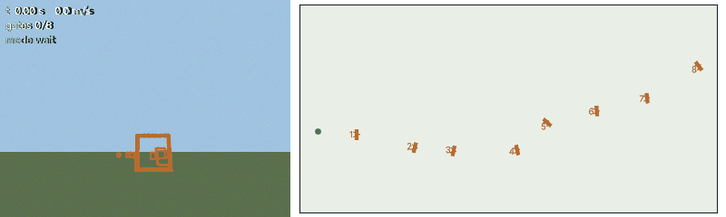

# Vision-Based Autonomous Drone Racing

A simulated racing quadrotor flies a course of identical square gates at 8 m/s using **only
its monocular FPV camera and IMU** — no GPS, no depth sensor, no map of where the gates are.
Everything is self-contained Python: the simulator renders real camera images, and the
flight stack has to find the gates in the pixels.



*Course seed 0, default configuration, real-time playback at 8 fps. Left: the 320×240 camera
image the flight stack actually receives, with a HUD (time, true speed, gates passed, tracker
mode). Right: true trajectory over the course (for viewing only — the drone never gets the
map). Regenerate with `python -m vdr.flightviz --seed 0`.*

[](https://github.com/dom-t23/vision-drone-racing/actions/workflows/tests.yml)

## Results

Benchmark: 50 seeded random courses × 8 gates, default configuration, race clock on
(each run must average ≥ 5 m/s or it times out). Every number links to a committed results
file; see [NIGHTLY_LOG.md](NIGHTLY_LOG.md) for the history.

| configuration | gate pass rate | courses completed | mean lap |
|---|---|---|---|
| **baseline (8 m/s)** | **95.2%** | 94% | 12.1 s |
| same, robust-outline check off | 94.5% | 90% | 12.0 s |
| earlier baseline, lost-target recovery off | 89.2% | 82% | 11.9 s |
| earlier baseline, chi-squared gating off | 75.5% | 60% | 12.0 s |
| cruise 4 m/s (race clock expires) | 57.0% | 0% | — |

Files: [`baseline`](results/2026-10-11_68513f6_baseline.json),
[`no robust-outline check`](results/2026-10-11_68513f6_ablation-no-robust-inner.json),
[`no recovery`](results/2026-10-10_0181f50_ablation-no-recovery.json),
[`no chi2`](results/2026-10-07_c25234a_ablation-no-chi2.json),
[`4 m/s`](results/2026-10-07_c25234a_ablation-4mps.json).

## How it works

```
 camera 40 Hz ─► gate detector ─► IPPE_SQUARE PnP ─► chi-squared gate ─┐
                 (HSV, contours,   (gravity resolves                   │
                  RANSAC quads)     the square's symmetry)              ▼
 IMU 200 Hz ───────────────────────────────────────────────► ESKF in the target gate's frame
                                                                        │
            gate tracking: target / next-gate hypotheses / handoff ◄────┤
                                                                        ▼
                     cubic terminal-velocity guidance ─► attitude control ─► thrust + body rates
```

- **Detection.** Gates are found by colour, then each contour is fitted with a
  quadrilateral. Because every gate is identical, the next gate is usually seen *through* or
  *touching* the one being approached; merged outlines are handled with a RANSAC fit of the
  four dominant edges, and each gate's inner opening is used as a second, independent square.
- **Pose from one square.** OpenCV's `solvePnP` with `SOLVEPNP_IPPE_SQUARE` gives the gate's
  pose from its four corners. A square has 4-fold symmetry, so the corner labelling is fixed
  using gravity (gates are upright); the planar "flip" ambiguity is left to the filter.
- **State estimation without a map.** An error-state Kalman filter (15 states: position,
  velocity, attitude, accelerometer and gyro biases) runs in the frame of the gate the drone
  is flying to. The IMU drives the prediction at 200 Hz; each detection gives a measurement
  of the gate centre in the camera frame and a weaker attitude measurement. Both pass a
  chi-squared test on the innovation, so misdetections and wrong PnP solutions are rejected.
- **Which gate is next?** With no IDs, the rule is "the nearest gate ahead". Gates seen beyond
  the target are clustered into hypotheses while approaching; on passing, the filter is
  re-expressed in the next gate's frame. If a nearer gate appears in front, the drone
  retargets.
- **Guidance and control.** A receding-horizon cubic brings the drone to the gate centre with
  its velocity along the gate normal; a geometric attitude controller turns the desired
  acceleration into collective thrust and body-rate commands, as a pilot would in acro mode.

## Simulator

`vdr/sim`: rigid-body quadrotor (thrust + body-rate inputs with motor and rate-loop lags,
rotor and air drag), IMU with white noise and drifting biases, a 320×240 pinhole FPV camera
pitched up 20°, and seeded courses whose layout guarantees that after each gate the next one
is in view and is the nearest gate ahead. The simulator and the flight stack only share the
small contract in [`vdr/interface.py`](vdr/interface.py); a test fails if the autonomy ever
imports the simulator or the contract grows a ground-truth field.

## Run it

```bash
pip install -r requirements.txt
python -m pytest -q                         # 43 tests, ~12 s
python -m vdr.harness --runs 50 --seed 0    # the benchmark (~1 min on 2 cores)
python -m vdr.harness --runs 50 --flag chi2_gating=false      # an ablation
python -m vdr.harness --runs 50 --sim pixel_noise_sigma=8     # a harder world
```

Every run is deterministic for a given seed and configuration, so a change can be evaluated
by re-running the same 50 courses with it switched on and off.

## Layout

```
vdr/interface.py   the sim <-> autonomy contract
vdr/sim/           dynamics, IMU, camera renderer, courses, scoring
vdr/autonomy/      detector, PnP, ESKF, guidance/control, the flight stack
vdr/harness.py     regression harness -> results/*.json
tests/             unit and end-to-end tests
```

[ROADMAP.md](ROADMAP.md) lists what's next.
