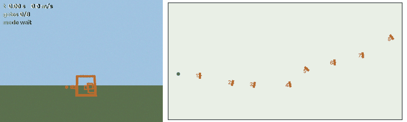
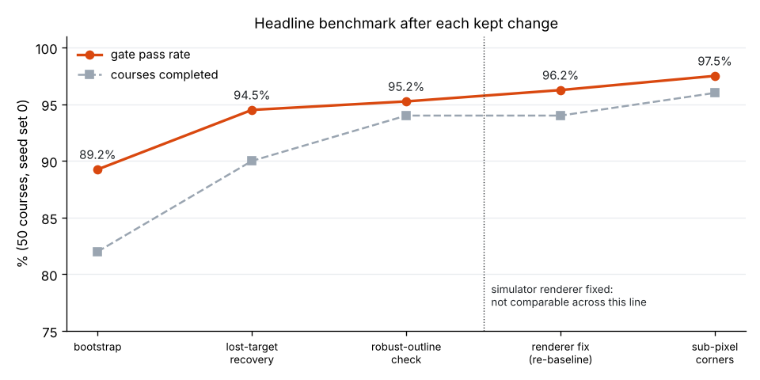

# Vision-based drone racing

A simulated racing quadrotor flies a course of eight identical square gates at 8 m/s using
only a forward-facing camera and an IMU. There's no GPS, no depth sensor and no map of where
the gates are. The simulator renders real camera images, and the flight stack has to find the
gates in the pixels. Everything is self-contained Python.



*Course seed 1 in real time. Left: the 320×240 image the flight stack actually gets, with a
HUD. Right: the true trajectory, for viewing only (the drone never sees the map).
Regenerate with `python -m vdr.flightviz --seed 1`.*

[](https://github.com/dom-t23/vision-drone-racing/actions/workflows/tests.yml)

## Try it

- **In the browser:** the [flight replay](https://dom-t23.github.io/vision-drone-racing/)
  shows recorded flights with the onboard camera, the detected gate outlines and the drone's
  own position estimate.
- **Desktop app:** download the zip for Windows, macOS or Linux from
  [Releases](https://github.com/dom-t23/vision-drone-racing/releases), unzip it and run
  `vdr-racing` (`vdr-racing.exe` on Windows). The builds aren't code-signed, so on macOS
  right-click → Open the first time, and on Windows choose "More info → Run anyway".
- **With Python 3.10+:** `pipx install git+https://github.com/dom-t23/vision-drone-racing`,
  then `vdr-racing`, `vdr-racing fly --seed 3 --live` or `vdr-racing bench --runs 8`.

## Results

The benchmark is 50 random courses of 8 gates, repeated on six seed sets (300 courses, 2400
gates). A run ends at the first crash or missed gate, and it has to average at least 5 m/s
along the course or it times out, so slowing down doesn't score.

| | gate pass rate | courses completed | mean lap (per seed set) |
|---|---|---|---|
| camera + IMU (default) | **98.58%** | 294 / 300 | 11.45–11.67 s |
| camera only, no IMU | 97.46% | 289 / 300 | 11.42–11.65 s |

Every course has 20 pieces of clutter beside it (banners, panels, cones) painted in the gates'
own orange, so colour alone can't separate a gate from a distraction. Before the clutter was
added the stack passed 99.83% of gates, and the benchmark had stopped being able to tell good
changes from bad ones. Of the six failures left, five are clutter taken for a gate and one is
a course whose first gate never gives a usable square.

Single 50-course sets move by a run or two from noise alone (seed set 0 on its own scores
95.75%), so the pooled number is the one to quote. Every figure here comes from a committed
file in [`results/`](results/); the file names, per-seed tables and the value of each component
switched off are in [section 2 of the write-up](docs/WRITEUP.md#2-results).



## How it works

```
 camera 40 Hz ─► gate detector ─► IPPE_SQUARE PnP ─► chi-squared gate ─┐
                 (HSV, contours,   (gravity resolves                   │
                  RANSAC quads)     the square's symmetry)              ▼
 IMU 200 Hz ───────────────────────────────────────────────► ESKF in the target gate's frame
                                                                        │
            gate tracking: target / next-gate hypotheses / handoff ◄────┤
                                                                        ▼
                     cubic terminal-velocity guidance ─► attitude control ─► thrust + body rates
```

- **Finding gates.** Gates are found by colour and each outline is fitted with a
  quadrilateral. Because they're identical, the next gate is usually seen through or touching
  the current one, so merged outlines get a RANSAC fit of their four main edges, and each
  gate's inner opening is used as a second square.
- **Pose from one square.** `solvePnP` with `IPPE_SQUARE` gives the gate's pose from its four
  corners. A square looks the same rotated by 90°, so gravity (gates are upright) fixes which
  corner is which. The pose is then refined with the gate held upright, solving only for
  position and yaw.
- **State estimation without a map.** A 15-state error-state Kalman filter runs in the frame
  of the gate the drone is heading for. The IMU drives the prediction at 200 Hz; each detection
  updates it with the gate centre in the camera frame and a weaker attitude measurement. A
  chi-squared test on each innovation throws out misdetections and wrong PnP solutions.
- **Which gate is next?** The gates have no IDs, so the rule is "the nearest gate ahead".
  Gates seen beyond the current one are grouped into hypotheses on the way in; after a pass
  the filter is re-expressed in the next gate's frame.
- **Guidance and control.** A cubic trajectory brings the drone to the gate centre moving
  along the gate's normal, with its time-to-go chosen so the sideways acceleration stays
  within the drone's limits. A geometric attitude controller turns that into collective
  thrust and body rates, the way a pilot flies in acro mode.

## Simulator

[`vdr/sim/`](vdr/sim) is a rigid-body quadrotor with motor and rate-loop lags and drag, an IMU
with noise and drifting biases, a 320×240 pinhole camera pitched up 20°, and a seeded course
generator. Camera latency and motion blur are available but off by default
([write-up section 4.1](docs/WRITEUP.md#41-sensor-sensitivity)); `--sim n_distractors=0` gives
the clean world.

The simulator and the flight stack only share the small contract in
[`vdr/interface.py`](vdr/interface.py), and a test fails if the autonomy ever imports simulator
code or the contract gains a ground-truth field. With `--link udp` the flight stack runs as a
separate process talking to the simulator over UDP, and gives identical results.

## Run it

On Windows, double-click `run_ui.bat` for the desktop launcher (the first run sets up a
`.venv`). Anywhere else, `pip install -r requirements.txt` then `python -m vdr.ui`.

```bash
pip install -r requirements.txt
python -m pytest -q                                       # 87 tests, about a minute
python -m vdr.harness --runs 50 --seed 0                  # the benchmark (~2.5 min on 2 cores)
python -m vdr.harness --runs 50 --flag chi2_gating=false  # switch a component off
python -m vdr.harness --runs 50 --sim pixel_noise_sigma=8 # make the world harder
python -m vdr.harness --runs 50 --flag camera_only=true   # no IMU
python -m vdr.flightviz --seed 0 --live                   # watch one flight
```

Runs are deterministic for a given seed and configuration, so a change is tested by flying the
same 50 courses with it on and off.

To build the desktop app: `pip install . pyinstaller && python packaging/build.py`. Pushing a
`v*` tag builds all three platforms in CI and attaches them to a release.

## Layout

```
vdr/interface.py   the sim <-> autonomy contract
vdr/sim/           dynamics, IMU, camera renderer, courses, scoring
vdr/autonomy/      detector, PnP, ESKF, guidance/control, the flight stack
vdr/link/          UDP link mode
vdr/harness.py     benchmark harness -> results/*.json
vdr/report.py      write-up figures from committed results
vdr/ui.py, app.py  desktop launcher and the `vdr-racing` command
vdr/demo.py        recordings for the browser replay (docs/demo/)
packaging/         PyInstaller build
tests/             unit and end-to-end tests
```

## How this was built

I set the problem and the design decisions that stay fixed: acro-mode thrust and body-rate
commands, identical gates with no IDs, a strict wall between the simulator and the flight
stack, and the benchmark rules (the race clock, no slowing down to gain pass rate, and every
published number backed by a committed results file). Those rules are in
[`CLAUDE.md`](CLAUDE.md).

Most of the code was written by an AI coding agent (Claude) in scheduled overnight runs. Each
night it re-ran the benchmark, tried one change behind a flag, A/B-tested it on the same
courses and logged the outcome in [`NIGHTLY_LOG.md`](NIGHTLY_LOG.md), including the ideas
that didn't work. I reviewed the results, and worked through some changes with Claude
directly, including the desktop launcher, live playback and a fix to the filter's covariance
when it switches gate frames.

The full write-up (pipeline, filter design, evaluation method and debugging stories) is in
[docs/WRITEUP.md](docs/WRITEUP.md), and [ROADMAP.md](ROADMAP.md) has what's next.
