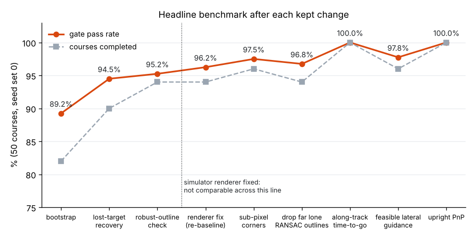
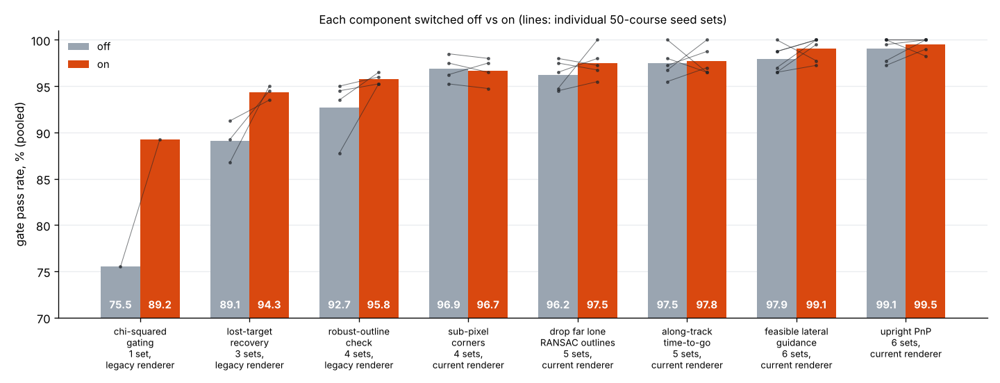
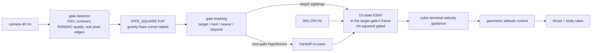
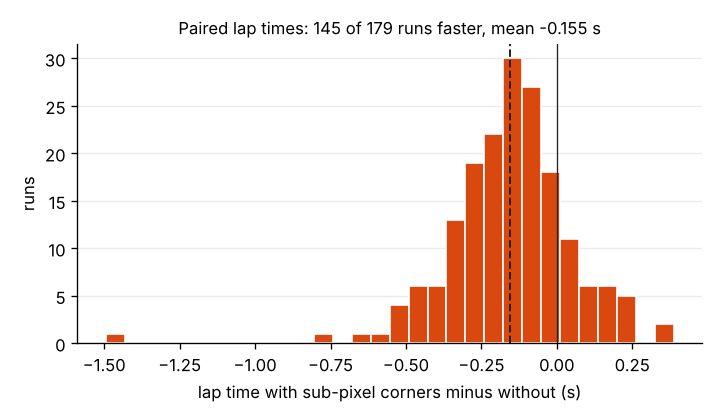
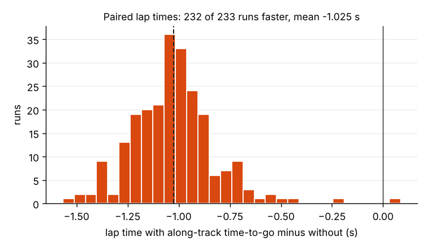
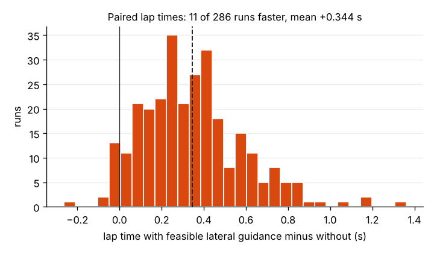
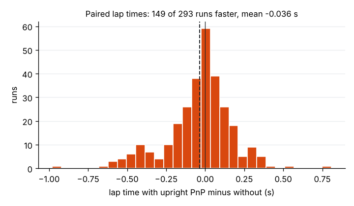

# Vision-only drone racing: write-up

A racing quadrotor has to fly through eight identical square gates at 8 m/s using only a
320×240 forward camera and an IMU. There is no GPS, no depth sensor, no map, and the gates
carry no IDs. This document explains how the flight stack works, how it is evaluated, and
what went wrong along the way. Every number below comes from a committed file in
[`results/`](../results); the figures are regenerated from those files with
`python -m vdr.report`.

## 1. The problem and its rules

| | |
|---|---|
| **Sensors** | 40 Hz monocular FPV camera (320×240, 100° horizontal FOV, pitched up 20°, pixel noise σ = 3), 200 Hz IMU with white noise and drifting biases |
| **Actuation** | Acro mode: collective thrust + body rates, the way a human FPV pilot flies (rate loops modelled as first-order lags) |
| **Course** | 8 identical upright gates (1.7 m outer, 1.4 m opening), 6–11 m apart, turns up to 35°, heights 1.4–3.0 m. The generator guarantees the next gate is visible and is the nearest gate ahead after each pass |
| **Scoring** | Gates must be passed in order. A run ends at the first crash, missed gate, wrong gate or timeout. A race clock requires ≥ 5 m/s average along the gate-to-gate path |
| **Separation** | The autonomy sees only [`vdr/interface.py`](../vdr/interface.py): images, IMU samples, camera intrinsics/extrinsics, gate size, vehicle limits. `tests/test_separation.py` fails if it imports simulator code or the contract grows a ground-truth field. In UDP link mode the autonomy is a separate process |

The **headline metric** is the gate pass rate over 50 seeded courses (400 gates), seed set 0,
default configuration.

## 2. Results

| configuration (current simulator) | gate pass rate | courses completed | mean lap |
|---|---|---|---|
| **default** | **100.0%** | 100% | 11.60 s |
| upright PnP off | 97.8% | 96% | 11.59 s |
| also feasible lateral guidance off | 100.0% | 100% | 11.26 s |
| also along-track time-to-go off | 96.8% | 94% | 12.27 s |
| also far lone RANSAC outlines kept | 97.5% | 96% | 12.33 s |
| also sub-pixel corners off | 96.2% | 94% | 12.5 s |

Source: [`2026-10-19_9acf025_baseline.json`](../results/2026-10-19_9acf025_baseline.json),
[`2026-10-16_3395fb0_baseline.json`](../results/2026-10-16_3395fb0_baseline.json),
[`2026-10-15_1d4bb7f_baseline.json`](../results/2026-10-15_1d4bb7f_baseline.json),
[`2026-10-13_0f1e256_baseline.json`](../results/2026-10-13_0f1e256_baseline.json),
[`2026-10-12_3b6cbbb_baseline.json`](../results/2026-10-12_3b6cbbb_baseline.json),
[`2026-10-12_06ceff9_baseline.json`](../results/2026-10-12_06ceff9_baseline.json).

**One seed set is not enough; the pooled number is the honest one.** Over six sets of 50
courses (seeds 0, 1000, 2000, 3000, 4000, 5000; 2400 gates) the default passes **99.54%** of
gates and completes 298 of 300 courses (per set 100.0 / 99.0 / 100.0 / 100.0 / 100.0 / 98.2%,
laps 11.4–11.7 s; `results/2026-10-19_9acf025_baseline.json` and
`results/2026-10-19_da2703a_ab-upright-tilt-seed{1000..5000}.json`, flown with the same code as
the default). The two failures are seed 1005 (`crash_gate` at gate 4) and seed 5007
(`wrong_gate` at gate 1). The latest change, a gravity-constrained "upright" PnP that gives a
better gate yaw (section 6.9), raised the pooled pass rate from 99.08% to 99.54% at unchanged
lap times. The one before it, guidance that plans its sideways correction within the
acceleration limit (section 6.7), raised it from 97.92% to 99.08% for 3% of lap time, and on
seed set 0 alone went *down*, 100.0% → 97.8%: single sets are noisy, and two runs either way is
within noise for one set.

The dotted line marks a simulator fix (section 6.4): the renderer had been painting every gate
about 0.7 px too wide, which the perception had silently adapted to. Numbers on either side of
that line are measured in different worlds and are not compared directly.

What each piece is worth, switched off and on over the same courses (bars pooled over the seed
sets named; each grey line is one 50-course set):

| component | seed sets | off → on | file prefix |
|---|---|---|---|
| chi-squared gating | 1 | 75.5% → 89.2% | `2026-10-07_c25234a_` |
| lost-target recovery | 3 | 89.1% → 94.3% | `2026-10-10_0181f50_` |
| robust-outline check | 4 | 92.7% → 95.8% | `2026-10-11_68513f6_` |
| sub-pixel corners | 4 | 96.9% → 96.7% (laps 0.155 s faster) | `2026-10-12_06ceff9_` |
| drop far lone RANSAC outlines | 5 | 96.25% → 97.50% (laps unchanged) | `2026-10-1{2,3}_b6a6a31_` |
| along-track time-to-go | 5 | 97.50% → 97.75% (laps 1.03 s faster) | `2026-10-1{4,5}_131d93c_ab-attgo` |
| feasible lateral guidance | 6 | 97.92% → 99.08% (laps 0.34 s slower, +3%) | `2026-10-1{5,6}_d37cf14_ab-feaslat` |
| upright PnP (tilt from IPPE) | 6 | 99.08% → 99.54% (laps flat, −0.036 s) | `2026-10-19_da2703a_ab-upright-tilt` |
| *tried, left off:* lateral-first saturation | 5 | 97.50% → 98.25% (completed 240 → 240) | `2026-10-1{3,4}_2d7e3f6_` |
| *tried, left off:* handoff yaw sigma floor | 6 | 99.08% → 99.17% (1 run rescued, 0 broken) | `2026-10-17_cbd0150_ab-yawfloor` |
| *tried, left off:* upright PnP with a yaw-only update | 6 | 99.08% → 97.71% (completed 295 → 289) | `2026-10-1{8,9}_bc81c40_ab-upright` |
| *tried, left off:* joint outline + opening fit | 6 | 99.54% → 99.54% (1 rescued, 1 broken) | `2026-10-{19,20}_42e68bf_ab-joint` |

The first three were measured on the earlier renderer. Sub-pixel corners did not change the
pass rate; they were kept because they made laps faster at equal pass rate (section 5), and
the same holds for along-track time-to-go. Feasible lateral guidance is slower but within the
5% the pace rule allows, and it completed 5 more of 300 courses (9 rescued, 4 broken).
Lateral-first saturation raised the gate count but not the number of completed courses (it
rescued 8 runs and broke 8, which then failed later in the course), so it was not counted as a
clear win (section 6.6). The handoff yaw floor changed one run in 300 (section 6.8). Upright
PnP is a small pass-rate gain on its own, but it is pooled over six sets and comes with a
consistent mechanism: per-run yaw error RMS fell from 4.20° to 2.87° on average and the median
estimation error fell on all six sets. The yaw-only variant and the joint fit are sections 6.9
and 6.10.

Two reference points from the bootstrap: at 4 m/s with no race clock the stack passes 97.8% of
gates ([`0423930_ablation-4mps-noclock`](../results/2026-10-07_0423930_ablation-4mps-noclock.json))
but every run would time out under the clock (57.0%,
[`c25234a_ablation-4mps`](../results/2026-10-07_c25234a_ablation-4mps.json)). Flying slowly is
not a way to score, which is why the benchmark runs at 8 m/s.

## 3. Pipeline

### 3.1 Detection ([`detector.py`](../vdr/autonomy/detector.py))

HSV threshold for the orange paint, then contours with a two-level hierarchy, so each gate
gives up to two squares: its **outer boundary** and its **inner opening** (the hole). Each is
fitted with a quadrilateral by `approxPolyDP`.

Identical gates make this harder than it sounds: the next gate is usually seen *through* or
*touching* the current one, so the two blobs merge and the outline is no longer a 4-gon. The
fallback is sequential RANSAC: find the four dominant straight edges of the contour and
intersect them, treating the other gate's pixels as outliers. A fit is rejected unless its
edges cover ≥ 60% of the outline (otherwise it is probably two distant gates merged). Holes
often survive overlaps that ruin outlines, so unused holes become detections on their own.

Finally each quad edge is re-measured at sub-pixel precision: sample intensity profiles across
the edge, find where they cross half the paint-vs-background contrast, fit a line through the
crossings, and intersect neighbouring lines. On the current renderer this cuts corner RMS
error from ~0.8–0.9 px to 0.1–0.3 px.

### 3.2 Pose from one square ([`pnp.py`](../vdr/autonomy/pnp.py))

`cv2.solvePnP(..., SOLVEPNP_IPPE_SQUARE)` gives the gate pose from four corners. A square has
two ambiguities:

* **4-fold symmetry**: any cyclic relabelling of the corners fits equally well. Gates are
  upright, so the gate's "up" is the object axis closest to world up (from the filter's
  attitude, or the accelerometer before initialisation).
* **Planar flip**: IPPE returns two solutions, which are nearly equally good for small or
  distant squares. Both are kept and the filter's prediction picks one.

A single square gives good **position** (centimetres at 6 m) but poor **rotation** (5–30° at
6–11 m). The filter design follows from that.

**Upright refinement.** Gates are vertical, so once roll and pitch are known the gate pose has
4 unknowns (position + yaw), not 6. `pnp.refine_upright` runs Gauss-Newton on the 8 reprojection
residuals with the gate's up axis fixed to the filter's gravity direction, seeded from each
up-aligned IPPE solution; the two IPPE solutions usually converge to the same upright pose, so
the flip ambiguity mostly disappears. The filter takes **position and yaw** from the upright
fit and **roll and pitch** from the unconstrained IPPE solution, which does not depend on the
filter (section 6.9 says why that matters). Cost: about 2 ms per detection, the benchmark takes
~50% longer.

### 3.3 State estimation without a map ([`eskf.py`](../vdr/autonomy/eskf.py))

The drone does not know where the gates are, so there is no world map to localise in. Instead
the filter is expressed **in the frame of the gate it is flying to**: origin at the gate
centre, x through the gate, z up. Gates are upright and static, so this frame is gravity
aligned and inertial, and the IMU can be integrated in it directly.

* **State**: position, velocity, attitude, accelerometer bias, gyro bias. It is an
  error-state filter (15 error states, attitude error as a 3-vector rotation), following
  Solà's ESKF notes.
* **Prediction**: IMU at 200 Hz.
* **Main measurement**: the gate centre in the camera frame, `t_co`. Its noise is anisotropic:
  across the line of sight it is σ_px·d/f, along it roughly 0.7·σ_px·d²/(f·L). For example,
  with f ≈ 134 px, σ_px = 1.5 and the 1.7 m outline, that is about 0.11 m sideways but
  0.46 m in depth at 10 m.
* **Second measurement**: the relative attitude from PnP, with a much larger, distance-scaled
  noise, because single-square rotation is poor.
* **Initialisation**: roll and pitch from 40 averaged accelerometer samples while hovering
  (one sample tilted the filter by up to ~10°), position and yaw from the first PnP.

**Handoff.** While approaching a gate, detections far beyond it are clustered into hypotheses
for the *next* gate (position and yaw in the current gate frame). When the estimate crosses
x = +0.3 m the filter is re-expressed in the next gate's frame: rotate and translate p, v and
R, and inflate the covariance by the uncertainty of the next gate's estimated pose (position,
plus yaw uncertainty mapped through the lever arm). That uncertainty is floored at 8% of the
range at which the gate was seen, because far sightings share a depth bias.

### 3.4 Chi-squared gating

Every update first computes the innovation r and its predicted covariance S = HPHᵀ + R. If the
Mahalanobis distance rᵀS⁻¹r exceeds 11.345 (the 99% point of χ² with 3 degrees of freedom),
the measurement is rejected. This removes wrong IPPE flips, RANSAC fits that latched onto the
wrong gate, and detections of another gate that happened to fall inside the association radius.
Without it the pass rate drops from 89.2% to 75.5% on the bootstrap code. After 8 consecutive
rejects the filter re-initialises from the measurement, so a filter that has genuinely drifted
cannot lock itself out forever.

### 3.5 Which gate is next? ([`stack.py`](../vdr/autonomy/stack.py))

With identical gates, "which gate is this" comes entirely from geometry. Each detection, once
transformed into the current gate frame by the filter, falls into one category:

| category | rule | effect |
|---|---|---|
| target | within an association radius of the target (2 m + 0.1 m per metre of range, max 4 m) | filter update (if it passes χ²) |
| next gate | ≥ 3 m beyond the target, within a 60° cone of the pass direction | next-gate hypothesis |
| nearer gate | straight ahead and ≥ 2 m nearer than the target, seen 4 times | **retarget** to it |
| beyond gate | straight ahead just beyond an unseen target, seen 3 times, target missed for 3 frames | **lost-target recovery**: switch to it |

The association radius is generous on purpose: the χ² test, not the radius, decides whether a
detection is used. The last row exists because a depth-biased handoff can leave the real gate
2–5 m beyond the estimate: too far to associate, too near to be "next". Before recovery
existed such detections were silently dropped and the drone flew on IMU alone with a falsely
small covariance (section 6.2).

If the drone passes a gate without having seen the next one it enters SEARCH: stop and turn
slowly until a gate appears ahead.

### 3.6 Guidance and control ([`control.py`](../vdr/autonomy/control.py))

Far from the gate, guidance re-solves each tick for the unique cubic that starts at the current
position p and velocity v and reaches the gate centre at time-to-go T with velocity
v_f = (8 m/s, 0, 0) along the gate normal. Its initial acceleration has a closed form:

  a = (6 (p_f − p) − 2T (2v + v_f)) / T²

Time-to-go comes from the along-track motion only, T = 2(−p_x)/(v_x + |v_f|), so a drone on the
gate axis at cruise speed gets zero along-track demand. The lateral and vertical axes use the
same T floored at 0.3 s (their gain grows as 1/T²); the along-track axis is not floored. Inside
x > −1.2 m guidance switches to "hold the line": a velocity loop towards v_f plus lateral and
vertical position feedback. (A floor on T used instead made the drone brake to a stop 0.7 m
short of the gate.) The total demand is clipped to 14 m/s².

**Planning within the limit.** The cubic's acceleration is linear in time, so on each lateral
axis its largest value is at one end of the manoeuvre, and both ends have closed forms:
a(0) = (−6y − 4T v_y)/T² and a(T) = (6y + 2T v_y)/T² (gate at y = 0). Guidance picks the
shortest lateral time-to-go T_lat whose peak stays within 11 m/s². If that is later than the
along-track arrival, it buys the time by braking along x at a constant deceleration so the drone
reaches the gate plane at T_lat (never planning to arrive slower than 3 m/s, and braking only
with what the 14 m/s² limit leaves). Example: 1 m off the axis, 4 m out at 8 m/s, the plain
cubic asks for 24 m/s² sideways, which clipping cut to 14; the planned law asks for 11.3 sideways
and brakes at 6.9.

Control turns the desired acceleration into acro commands: thrust along the required specific
force (with a 55° tilt limit), a desired attitude from that axis plus the desired heading, and
body rates proportional to the geometric attitude error on SO(3) (Lee et al., 2010).

## 4. The simulator

[`vdr/sim/`](../vdr/sim) is written from scratch for this project. Rigid-body dynamics with
thrust and rate lags and linear plus quadratic drag; an IMU with white noise and random-walk
biases; a pinhole renderer that draws sky, ground and gate frames with area-coverage
anti-aliasing and pixel noise; a seeded course generator with visibility guarantees; and
lockstep scoring. Every "how hard is the world" knob is a `SimConfig` field, and the harness
can override any of them (`--sim pixel_noise_sigma=8`). The autonomy's own noise assumptions
live in `AutonomyConfig` and are deliberately not copied from the simulator.

## 5. How changes are evaluated

* **Deterministic seeds.** Each run is bit-for-bit reproducible for a given seed and
  configuration, so a change is evaluated by flying the *same* 50 courses with it off and on.
* **Experiment flags.** Every idea goes in behind an `AutonomyConfig` boolean, default off.
  It is kept (default flipped, flag kept for ablation) only if it clearly helps.
* **Noise.** Outcomes are chaotic: in one test, replacing an SVD line fit with a closed-form
  one changed corners by 1e-13 px yet altered 40+ of 50 trajectories and flipped 1–2 outcomes
  per seed set. Because a run ends at its first failure, one early crash can cost up to 2% of
  the 400 gates. So differences under ~8 percentage points on one set are treated as noise,
  and smaller effects are judged only pooled over several seed sets (0, 1000, 2000, 3000, 4000, and 5000 since run 13), with
  a set held out when a threshold was tuned on the others.
* **Pace rule.** A change counts only if the pass rate rises without the mean lap time getting
  more than 5% worse; going faster at equal pass rate also counts.
* **Paired lap times.** Mean lap time of completed runs mixes in *which* runs completed. For
  speed, only runs completed both ways are compared, seed by seed:

  Sub-pixel corners: 145 of 179 paired runs faster, mean −0.155 s (median −0.147 s).

  Along-track time-to-go: 232 of 233 paired runs faster, mean −1.025 s (median −1.033 s),
  about 8% of a lap.

  Feasible lateral guidance: 271 of 286 paired runs slower (11 faster, 4 equal), mean
  +0.344 s (median +0.324 s), about 3% of a lap: the price of braking when a correction
  would not fit.

  Upright PnP: 149 of 293 paired runs faster, mean −0.036 s (median −0.003 s): no change in
  pace.
* **Simulator changes** go in as a `SimConfig` field defaulting to the old behaviour, then the
  default is flipped in a separate commit and the benchmark re-baselined.

## 6. Debugging stories

### 6.1 Overlapping identical gates
At bring-up most runs never initialised: the next gate is seen through or touching the first
one, so the outline is not a 4-gon and `approxPolyDP` fails. RANSAC edge fitting plus using
hole contours as detections fixed it. Later, merged outlines sometimes failed the uprightness
check, so the stack falls back to the gate's own opening (89.2% at the end of bootstrap).

### 6.2 Phantom handoffs (89.2% → 94.5%)
Hooking the handoff with ground truth (diagnostics only, never fed back) showed that in 6 of
the 9 seed-0 failures the next gate's estimate was 2–5 m short. The real gate then fell into
no category: outside the association radius, not far enough to be "next", not nearer. The
filter flew about a second on IMU alone, declared a pass 2–3 m early and clipped the frame.
The fix was a rule that every detection must land in some category that can correct the
target (lost-target recovery). Pooled over 3 seed sets: 89.1% → 94.3%.

### 6.3 Measure bias per detection type (pooled 92.7% → 95.8%)
Comparing every PnP range with the nearest true gate, split by detection type, showed that
RANSAC outlines of merged gates read 16–20% too near at 7–16 m: the fit overshoots onto the
other gate, so the gate looks bigger. These are exactly the detections that make next-gate
sightings, so they caused the short handoffs. "Always use the opening" was noise and broke
some seeds; "use the opening only when the two size cues disagree by more than 8%" helped on
all four seed sets.

### 6.4 The bug was in the simulator
A first sub-pixel corner refinement made squares read *more* wrong, by exactly 1.0 px RMS at
every range. A constant pixel offset meant the edges were drawn in the wrong place: OpenCV's
`fillPoly(LINE_AA)` paints about 0.7 px beyond every edge (a 20 px square covers 456 px², not
400). The detector had been tuned to a renderer defect. The fix went into the simulator
(area-coverage anti-aliasing, 8× supersampled), followed by a re-baseline. With the corrected
renderer, sub-pixel corners have 0.1–0.3 px RMS error at 2–20 m.

### 6.5 A cue with nothing to check it against (pooled 96.25% → 97.50%)
After the renderer fix and sub-pixel corners, the same per-type bias measurement (seeds 0-19,
about 20 000 detections) showed clean outlines and openings within ~1% of the true range up
to 13 m. What was still wrong were RANSAC outlines with *no valid opening of their own*: the
6.3 check cannot run on them, and beyond 7 m they read gates a median 12% too near (about
three in four more than 5% near). Dropping them beyond 6 m measured range lowered the median
estimation error on all five seed sets (seed 0: 0.556 → 0.394 m), removed every
`missed_gate` outcome (4 → 0) and raised the pooled pass rate from 96.25% to 97.50% (11 runs
rescued, 4 broken) with unchanged lap times (paired mean −0.007 s over 229 runs). Re-tuning
the 8% disagreement threshold instead would have done little: on the same data, RANSAC
outlines beyond 7 m read a median 2.8% near with a 0% threshold and 3.5% near with 8%, and
about half stay more than 5% off either way, because more than half of them have no opening
to compare against.

### 6.6 The crashes were control, not perception (laps −1.03 s)
With perception fixed up, the remaining failures looked different. Re-flying the 10 failed
runs over five seed sets with truth logged showed every crash hitting the target gate's frame
0.5–0.8 m off centre, and in 8 of 10 the estimate was within 6 cm of the truth at impact: the
drone knew where the gate was but could not get there. The guidance was asking for 30–75 m/s²
against a 14 m/s² limit, and clipping the vector uniformly spent most of the budget on
along-track *braking*.

The first try reordered the clip (lateral first, along-track gets what is left). It rescued 8
runs and broke 8 others: with the full budget sideways until about 1.8 m out, the drone built
4–5 m/s of lateral speed it could not remove and overshot into the other side of the frame.
Left off.

The better question was why there was braking at all. Printing the demand per axis on a
nominal state (on the gate axis, at cruise speed) showed it: the 0.3 s floor on time-to-go is
active from about 2.4 m out at 8 m/s, so the cubic believes it will arrive *early* and brakes
(−27 m/s² at x = −2 m with 0.6 m lateral offset). Taking T from the along-track motion and
dropping the floor on that axis removed the phantom braking. Pooled pass rate stayed flat
(97.50% → 97.75%; 8 runs rescued, 7 broken) and laps got 1.03 s faster on 233 paired runs,
which counts as an improvement under the pace rule. The 7 broken runs are the same failure at
higher speed: lateral demand saturating close to the gate, often after a late correction
following a handoff.

### 6.7 Plan around the limit instead of clipping at it (pooled 97.92% → 99.08%)
Both attempts in 6.6 still let guidance ask for the impossible and then decided what to drop.
The fix was to never ask: because the cubic's acceleration is linear in time, its peak sideways
demand has a closed form, so guidance can choose the lateral time-to-go that keeps the peak at
11 m/s² and, when that is longer than the along-track arrival, brake along x to make the time
(section 3.6). Over six seed sets it rescued 9 runs (8 of them the lateral-saturation crashes
from 6.6) and broke 4, raising the pooled pass rate from 97.92% to 99.08% and completed courses
from 290 to 295, for 0.34 s (3%) of lap time. Re-flying the broken runs showed what comes next:
three were handoffs where the next gate's estimate started 2–4 m off sideways, and the new law
braked and chased it until sightings corrected it. Fixing one subsystem tends to expose the
next one.

### 6.8 An error the main measurement cannot see (handoff yaw)
Those 2–4 m post-handoff errors persisted for 0.5–0.7 s even though the first sighting after
each handoff was *accepted* by the χ² test within 0.01–0.08 s. The reason is geometric. The
filter lives in the target gate's frame, and its main measurement is the gate centre seen from
the camera (direction and range). If the next gate's *yaw* is estimated wrong by θ, the handoff
re-expresses the drone's pose in a frame rotated by θ about the gate centre: the estimated drone
is a rigid rotation of the true one about that centre, so the gate centre looks exactly where
it should and the innovation is zero. Only the weak PnP attitude update can see θ. Checked
against truth over 685 handoffs on seed sets 0 and 1000, the averaged next-gate yaw had an RMS
error of 9–10.5° (worse below 7 m), 8–11% of handoffs were more than 15° off, the failing ones
16–46°, and its claimed σ was 2–3× too small because sightings from one viewpoint share their
bias. Flooring that σ at 12° (so the attitude updates can pull it in) was flat: pooled
99.08% → 99.17%, one run rescued, none broken, so it was left off. A wider prior cannot help
much while the attitude measurement itself is single-square PnP rotation (5–30° noise); the
planned fix is a better yaw measurement (section 6.9).

### 6.9 Don't measure a quantity with the filter's own estimate (pooled 99.08% → 99.54%)
The better yaw measurement is the upright PnP of section 3.2. Offline, on synthetic corners with
0.5 px noise and 1° error in "up", it cut the drone's yaw error RMS from 3.3° to 2.1° at 2–5 m
and from 7.9° to 5.4° at 5–8 m (yaw errors over 15°: 8.0% → 1.2%). The first version also
replaced the 3-axis attitude update with a yaw-only one, since the constrained pose's roll and
pitch are just the filter's own values fed back. In flight it was *worse*: pooled 97.71%,
completed 289 instead of 295. It rescued 4 of the handoff-yaw runs and broke 10. Re-flying a
broken run with truth showed tilt error growing to 5° (RMS 2.4° vs 1.2° before): with no vision
tilt update, only the accelerometer constrains tilt, and an upright fit made with a tilted "up"
quietly absorbs that tilt error instead of exposing it. Constraining a measurement with the
estimate removes that quantity's observability. The fix was to keep an independent source:
roll and pitch from the unconstrained IPPE fit, yaw and position from the upright fit. That
version rescued 5 runs and broke 2 (pooled 99.08% → 99.54%, completed 295 → 298), with lap
times flat on 293 paired runs (−0.036 s). It helps camera-only mode (no IMU; the filter predicts
from the commanded thrust and rates) even more: pooled 92.96% before, 98.62% with it
(`results/2026-10-20_dcb8934_ab-camonly[-seedN].json`), probably because without a gyro the heading
between frames rests on the vision yaw (not yet checked against truth).

### 6.10 Measure the ceiling on real frames first (joint fit, flat)
Each gate shows two concentric squares, the outline and the opening, so the next idea was to
fit all 8 corners in one upright solve. The synthetic 0.5 px noise model predicted 15–20%
better yaw. In flight it was flat (pooled 99.54% → 99.54%, one run rescued and one broken), so
it was left off. Measuring on frames from the real renderer and detector (250 clean single-gate
detections per range band) showed why: with sub-pixel corners the outline alone already gives
yaw RMS 0.27° at 2–5 m, 0.77° at 5–8 m and 1.59° at 8–12 m, with range bias under 0.1%. The
joint fit only helps beyond 12 m. The synthetic model had predicted 1.5°, 4.6° and 9.3° for
the outline alone in the same bands, five to six times too pessimistic, so the remaining yaw error does not come from clean detections; it comes from
merged or overlapping gates and from averaging sightings taken from one viewpoint.

## 7. Limitations and next steps

* The two remaining failures over 300 courses (seeds 1005 and 5007) have not been diagnosed
  yet. Clean detections are now accurate (section 6.10), so the next perception work is
  measuring the error of merged and overlapping-gate detections on rendered multi-gate scenes,
  then a measurement covariance from the PnP Jacobian.
* The terminal "hold the line" law is weak; a miss-distance law for the last 1.2 m is planned.
* Guidance plans one gate at a time; a lookahead through the current *and* next gate would
  start turns earlier.
* The world is still clean: no latency, motion blur, lens distortion, lighting changes,
  distractors or wind. Each will be added as a `SimConfig` knob with a re-baseline.
* All results are from simulation; nothing here has flown on hardware.

See [ROADMAP.md](../ROADMAP.md) for the ranked list and [NIGHTLY_LOG.md](../NIGHTLY_LOG.md)
for the full history.
